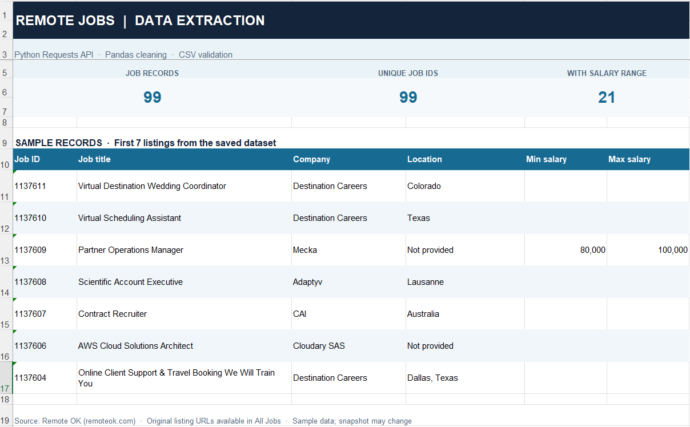
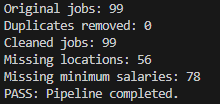

# Remote OK Data Pipeline

A personal Python project for collecting, cleaning, validating, and exporting remote job listings using the Remote OK public API.

## Features

- Extract job listings using Python Requests
- Process data with Pandas
- Remove duplicate job IDs
- Validate required fields, job URLs, and salary ranges
- Preserve missing values
- Export cleaned data to CSV

## Technologies

- Python
- Requests
- Pandas
- REST API / JSON

## Sample Results

A successful run collected 99 job listings with 8 data fields.

- 99 job listings
- 0 duplicate job IDs
- 56 missing locations
- 78 missing minimum salary values

Results may change as new jobs are posted.

## Installation

```bash
pip install -r requirements.txt
```

## Usage

```bash
python run_pipeline.py
```

The program creates `final_jobs.csv` after validation.

## Project Files

- `scraper_api.py` — Retrieves job data from the API
- `run_pipeline.py` — Extracts, cleans, validates, and exports the data
- `validate_api.py` — Validates a saved API dataset
- `clean_jobs.py` — Cleans an earlier CSV dataset
- `requirements.txt` — Lists Python dependencies

## Data Source

Source: [Remote OK](https://remoteok.com)

Original job URLs are preserved in the output dataset.

This is a personal learning project and is not affiliated with Remote OK. Follow the source's applicable data usage terms.

## Project Screenshots

### Sample Dataset



### Pipeline Execution



